```mermaid
flowchart TB
    %% =========================================================================
    %% DOCSCOUT SYSTEM ARCHITECTURE (VERTICAL STACK OF HORIZONTAL SWIMLANES)
    %% Top: Ingestion  |  Mid-Top: Serving & Retrieval  |  Mid-Bottom: Storage  |  Bottom: Evals
    %% =========================================================================

    %% -------------------------------------------------------------------------
    %% LANE 1: OFFLINE INGESTION PIPELINE (Top Swimlane)
    %% -------------------------------------------------------------------------
    subgraph LANE1["1. Offline Regulatory Ingestion Pipeline (app/ingest · No Deploy Credentials)"]
        direction LR
        SRC["Regulatory Sources<br/>RBI &amp; SEBI Portals<br/><i>(Read-Only HTTPS)</i>"]
        FETCH["1. Allowlist Fetch<br/><code>httpx</code> · 3 Verified Domains<br/><i>Host Allowlist (FR-1)</i>"]
        EXTRACT["2. Pluggable Extract<br/><code>pypdf</code> / <code>pdfplumber</code><br/><i>Layout &amp; Table Parser (ADR-0022)</i>"]
        GUARD["3. Guard &amp; Clean<br/>&gt; 500 Clean Chars<br/><i>Mojibake Strip (FR-3)</i>"]
        CHUNK["4. Chunker (ADR-0003)<br/>1,000 Chars · 150 Overlap<br/><b>UUIDv5 IDs</b> (FR-8)"]
        EMBED["5. Vector Embedder<br/><code>bge-small-en-v1.5</code><br/><i>384d Unit (ADR-0002)</i>"]
        GRAPH_EXT["6. Graph Extractor<br/>Provisions &amp; Citations<br/><i>Clause Links (ADR-0020)</i>"]
        SCAN["7. PII &amp; Secret Scan<br/>Credentials &amp; PII<br/><i>Masking (ADR-0015)</i>"]

        SRC --> FETCH --> EXTRACT --> GUARD --> CHUNK --> EMBED --> GRAPH_EXT --> SCAN
    end

    %% -------------------------------------------------------------------------
    %% LANE 2: ONLINE SERVING & HYBRID RETRIEVAL (Second Swimlane)
    %% -------------------------------------------------------------------------
    subgraph LANE2["2. Online Serving & Hybrid Retrieval Engine (app/api &amp; app/retrieval · FastAPI)"]
        direction LR
        CLIENTS["Compliance Analyst <i>(React Console)</i><br/>&amp; API Clients <i>(HTTPS / REST)</i>"]
        GATEWAY["API Gateway (FastAPI)<br/><code>X-API-Key</code> · Rate Limiter<br/><i>Audit Logger · Probes (FR-20, FR-21)</i>"]
        EXP["Domain Expander<br/>36+ Regulatory Terms<br/><i>HyDE (ADR-0017)</i>"]
        FILT["Metadata Filter<br/>Authority · Dates · Currency<br/><i>SQL &amp; BM25 (ADR-0016)</i>"]
        DUAL["Dual-Arm Retrieval<br/>BM25 (Exact Circular IDs)<br/>+ Dense HNSW KNN (ADR-0006)"]
        FUSION["Arm-Anchored RRF<br/>k=60 · Depth 50<br/><b>Top-1 Guarantee</b> (ADR-0007)"]
        GRAPH["Graph Traversal<br/>1-Hop Provision Links<br/><i>Fallback to RRF (ADR-0020)</i>"]
        CACHE[("In-Process TTL Cache<br/>Invalidation on Supersession<br/><i>(ADR-0014)</i>")]

        CLIENTS --> GATEWAY --> EXP --> FILT --> DUAL --> FUSION --> GRAPH --> CACHE
    end

    %% -------------------------------------------------------------------------
    %% LANE 3: GROUNDED GENERATION & RESEARCH AGENT (Third Swimlane)
    %% -------------------------------------------------------------------------
    subgraph LANE3["3. Grounded Generation & Agentic Synthesis Tier (app/generate)"]
        direction LR
        DELIMIT["Context Delimiter &amp; Canary Defense<br/>Strict <code>&lt;document&gt;</code> Tags (Data-Not-Instructions)<br/><i>Prompt Canary Token Defense (FR-12, S-7)</i>"]
        GEN_ANS["Grounded Generator (ADR-0011)<br/>Deterministic Citation Validator (FR-11)<br/><i>Calibrated Explicit Refusal (FR-13)</i>"]
        GEN_AGENT["4-Stage Research Agent (ADR-0021)<br/>1. Plan (Aspects) → 2. Retrieve (Hybrid)<br/>3. Synthesize (Tables) → 4. Critique"]

        OUT_SEARCH["POST /v1/search<br/><i>Ranked Evidence Passages</i>"]
        OUT_ANS["POST /v1/answer<br/><i>Grounded Answer &amp; Citations</i>"]
        OUT_RES["POST /v1/research<br/><i>Comparative Condition Tables</i>"]

        DELIMIT --> GEN_ANS --> OUT_ANS
        GEN_AGENT --> OUT_RES
    end

    %% -------------------------------------------------------------------------
    %% LANE 4: PERSISTENCE ENGINE (Fourth Swimlane)
    %% -------------------------------------------------------------------------
    subgraph LANE4["4. Core Persistence Engine (PostgreSQL 18.6 + pgvector 0.8.6)"]
        direction LR
        DB_DOCS[("<code>documents</code> &amp; <code>versions</code><br/>Canonical URL · SHA-256 · is_current")]
        DB_CHUNKS[("<code>chunks</code> (UUIDv5 PK)<br/>GIN (tsv) · HNSW Cosine (384d vector)")]
        DB_GRAPH[("<code>graph_nodes</code> &amp; <code>edges</code><br/>Provisions · cites/amends/supersedes")]
        DB_WORK[("<code>workspaces</code> &amp; <code>artifacts</code><br/>Condition Tables · Execution Traces")]
        DB_AUDIT[("<code>retrieval_audit_log</code> &amp; <code>sync_state</code><br/>Append-Only Log · Staleness Singleton")]
    end

    %% -------------------------------------------------------------------------
    %% LANE 5: EVALUATION & OPTIONAL INTEGRATIONS (Bottom Swimlane)
    %% -------------------------------------------------------------------------
    subgraph LANE5["5. Offline Quality Verification & Optional Integrations (app/evals)"]
        direction LR

        subgraph EVAL_SUB["Offline Evaluation &amp; CI Gate"]
            direction LR
            GOLD["Gold Set v2.0.0 (ADR-0012)<br/>425 Curated Items (14.1% Refusal)"]
            SCORERS["Deterministic Scorers (FR-26)<br/>Recall@1/5/10 · MRR · nDCG@5 · Citation P/R"]
            JUDGE["Calibrated LLM Judge (ADR-0011)<br/>Kappa 1.000 / 0.844 (80 Items)"]
            GATE["CI Regression Gate (FR-28)<br/><code>make eval-gate</code> (&lt; 1pp Delta)"]

            GOLD --> SCORERS & JUDGE --> GATE
        end

        subgraph OPT_SUB["Optional External Integrations (Config-Gated)"]
            direction LR
            OPT_AUTH0["Auth0 IdP (ADR-0024)<br/>OpenID Connect / OAuth 2.0 (RS256)"]
            OPT_OCR["OCR.space Cloud (ADR-0024)<br/>PDF Fallback (&le;3 Pages · Cached)"]
            OPT_BREVO["Brevo Email (ADR-0024)<br/>Regulatory Topic Digests (RFC-8058)"]
        end
    end

    %% -------------------------------------------------------------------------
    %% CROSS-LANE FLOWS & DATA PIPELINES
    %% -------------------------------------------------------------------------
    %% Ingestion writes to Database
    SCAN -.->|Insert Chunks, Vectors, Graph &amp; Audit| LANE4

    %% Retrieval reads from Database
    DUAL -.->|HNSW Cosine Search &amp; GIN FTS| DB_CHUNKS
    GRAPH -.->|1-Hop Provision Traversal| DB_GRAPH
    GATEWAY -.->|Append Audit Record| DB_AUDIT

    %% Serving to Generation
    CACHE -->|Ranked Passages| OUT_SEARCH
    CACHE -->|Evidence Context Chunks| DELIMIT
    GATEWAY -.->|Research Inquiries| GEN_AGENT
    GEN_AGENT -.->|Persist Workspaces &amp; Tables| DB_WORK
    GEN_AGENT -.->|Multi-Aspect Sub-queries| EXP

    %% Evaluation reads from DB & Generator
    DB_CHUNKS -.->|Corpus Chunks| SCORERS
    GEN_ANS -.->|Evaluated Answers| JUDGE

    %% Optional Integrations
    GATEWAY -.->|Optional: JWT Bearer Auth| OPT_AUTH0
    EXTRACT -.->|Optional: Scanned PDF Fallback| OPT_OCR
    OPT_BREVO -.->|Optional: Topic Digests| DB_DOCS

    %% =========================================================================
    %% STYLING CLASSES (Restrained, professional engineering palette)
    %% =========================================================================
    classDef sourceNode fill:#f0fdf4,stroke:#16a34a,stroke-width:1.5px,color:#14532d;
    classDef clientNode fill:#eff6ff,stroke:#2563eb,stroke-width:1.5px,color:#1e3a8a;
    classDef ingestNode fill:#f8fafc,stroke:#475569,stroke-width:1.5px,color:#0f172a;
    classDef gwNode fill:#f1f5f9,stroke:#334155,stroke-width:1.5px,color:#0f172a;
    classDef retNode fill:#fefce8,stroke:#ca8a04,stroke-width:1.5px,color:#713f12;
    classDef genNode fill:#faf5ff,stroke:#9333ea,stroke-width:1.5px,color:#581c87;
    classDef storeNode fill:#f0f9ff,stroke:#0284c7,stroke-width:2px,color:#0c4a6e;
    classDef evalNode fill:#fff7ed,stroke:#ea580c,stroke-width:1.5px,color:#7c2d12;
    classDef outNode fill:#ecfdf5,stroke:#059669,stroke-width:1.5px,color:#064e3b;
    classDef optNode fill:#ffffff,stroke:#94a3b8,stroke-width:1.5px,stroke-dasharray: 4 4,color:#475569;

    class SRC sourceNode;
    class CLIENTS clientNode;
    class FETCH,EXTRACT,GUARD,CHUNK,EMBED,GRAPH_EXT,SCAN ingestNode;
    class GATEWAY gwNode;
    class EXP,FILT,DUAL,FUSION,GRAPH,CACHE retNode;
    class DELIMIT,GEN_ANS,GEN_AGENT genNode;
    class DB_DOCS,DB_CHUNKS,DB_GRAPH,DB_WORK,DB_AUDIT storeNode;
    class GOLD,SCORERS,JUDGE,GATE evalNode;
    class OUT_SEARCH,OUT_ANS,OUT_RES outNode;
    class OPT_AUTH0,OPT_OCR,OPT_BREVO optNode;
```

# DocScout System Architecture

**Status:** Authoritative system architecture diagram. Fully implemented, benchmarked, and verified across production containers.

  <a href="../assets/architecture-diagram.svg">🔍 Vector SVG Asset</a> ·
  <a href="../assets/architecture-diagram-dark.png">🌙 Dark Theme (PNG)</a> ·
  <a href="../assets/architecture-diagram-light.png">☀️ Light Theme (PNG)</a> ·
  <a href="system-diagram.mermaid">📄 Raw .mermaid Source</a>

---

## Trust Boundaries & Data Invariants

| Boundary | Architectural Rule & Enforcement Mechanism |
|---|---|
| **Internet &rarr; Ingestion** | All fetched regulatory text is **data, never instructions** (`SECURITY.md` S-7). Host allowlist strictly limits HTTP fetching to `rbi.org.in`, `rbidocs.rbi.org.in`, and `sebi.gov.in` (`app/ingest/allowlist.py`, FR-1). |
| **Ingestion &rarr; Deploy** | Isolated execution stages. Ingestion environment possesses **no deploy, cloud, or administrative credentials** (`SECURITY.md` S-4, FR-6). |
| **Retrieved Context &rarr; Generator** | Context chunks are encapsulated in strict `<document>` XML delimiters (`app/generate/prompt.py`, FR-12). System prompts explicitly instruct the model that content within delimiters cannot modify instructions. Prompt canary tokens guard against injection. |
| **API Gateway &rarr; Public Traffic** | All operational query endpoints require `X-API-Key` authentication with support for zero-downtime key rotation (`app/api/security.py`, FR-20). In-process sliding-window rate limiting prevents resource exhaustion (FR-21). |
| **Audit Forensics &rarr; Privacy** | The append-only audit log (`retrieval_audit_log`, ADR-0015) stores SHA-256 query hashes rather than plaintext questions or API keys, ensuring non-repudiation without logging customer PII. |
| **Optional Integrations &rarr; Core Pipeline** | Integrations (Auth0, Brevo, OCR.space per ADR-0024) are strictly config-gated. If credentials are unset or external APIs fail, DocScout fails safely or falls back to in-memory / local extractors without service disruption. |

---

## Component Reference

- **Offline Ingestion Pipeline (`app/ingest/`)**: Document fetching, clean text normalization, fixed-width chunking (1,000 chars / 150 overlap), `bge-small-en-v1.5` embeddings (384d), and PII scanning.
- **Single-Store PostgreSQL (`infra/initdb/`)**: Pinned PostgreSQL 18.6 with pgvector 0.8.6. Composite B-tree metadata indices, GIN full-text search indices, and HNSW cosine distance vector indices (`vector_cosine_ops`, $m=16, ef_{construction}=64$).
- **API Serving Gateway (`app/api/`)**: FastAPI HTTP endpoints, rate limiting, Prometheus metrics exposition, zero-DB `/healthz` liveness, and database-aware `/readyz` readiness checks.
- **Hybrid Retrieval (`app/retrieval/`)**: `DomainQueryExpander` (36+ regulatory terms & HyDE), in-query SQL/BM25 metadata filtering, Dual-Arm candidate generation (in-memory BM25 + dense pgvector KNN), and Arm-Anchored Reciprocal Rank Fusion ($k=60$).
- **Grounded Generation & Research Agent (`app/generate/`)**: Citation validation ensuring every cited chunk ID is verified in context (FR-11), calibrated refusal (FR-13), and 4-stage deterministic multi-aspect research agent producing condition tables (ADR-0021).
- **Evaluation & CI Gate (`app/evals/`)**: Committed gold set v2.0.0 (425 items), deterministic evaluation scorers, calibrated LLM judge (Cohen's $\kappa = 1.000 / 0.844$), and automated regression gate (`make eval-gate`).
